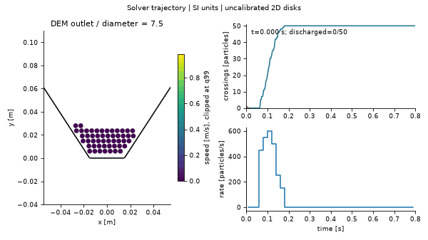
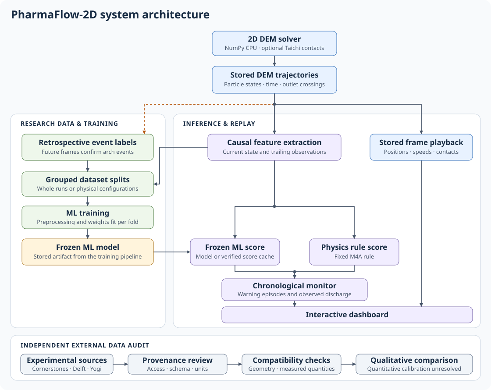
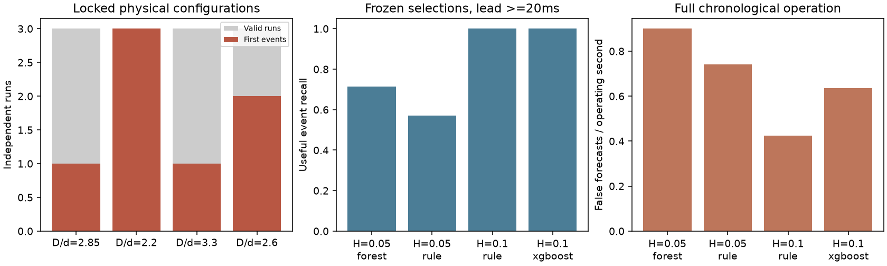
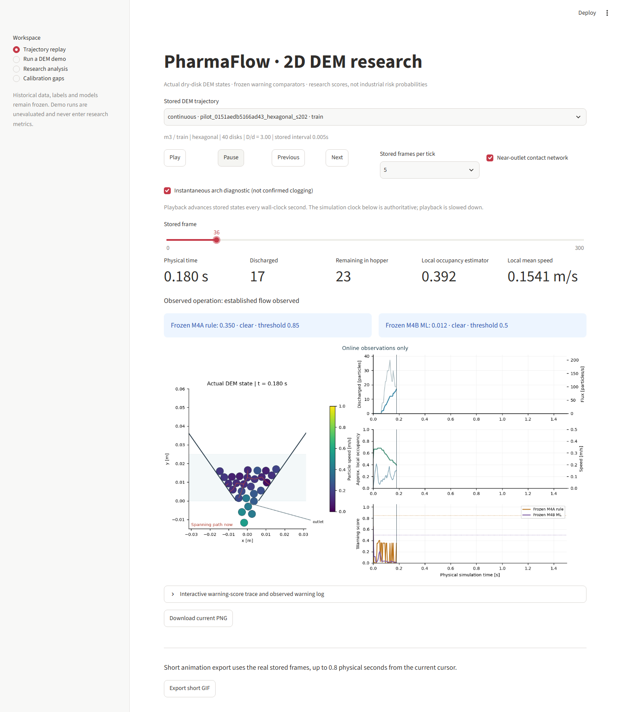

# PharmaFlow-2D

**A reproducible 2D Discrete Element Method research platform for granular hopper flow.** It combines a contact-physics solver, numerical verification, run-level datasets, cautious early-warning baselines, and a trajectory-driven dashboard. The model remains an **uncalibrated engineering simulation**; it is not an industrial or pharmaceutical process predictor.



*Stored states from the actual DEM solver. Particle color represents speed. This compact preview is committed so the core visual demo works from a fresh clone.*

## Research problem

A granular hopper can discharge continuously, pause and resume, or form a finite-lived arch above its outlet. PharmaFlow-2D asks two bounded questions: can a transparent 2D contact solver reproduce useful numerical behavior, and do observed particle dynamics support earlier warnings than simple physics rules?

DEM is used because particles and their contacts are the modeled state. CFD is suited to continuum fluid flow and transport; a coupled CFD–DEM model would be needed for resolved gas or liquid interactions and is outside this project. The implemented particles are dry, circular, strictly 2D disks.

## Capabilities

- **DEM simulation:** disk translation and rotation, gravity, normal contact, history-dependent tangential friction, Coulomb limits, hopper-wall contacts, neighbor search, guarded time integration, and reproducible trajectory export.
- **Numerical checks:** timestep refinement, contact and overlap diagnostics, conservation and boundary checks, deterministic replay, and Taichi CPU/CUDA contact-kernel parity. NumPy CPU execution remains available.
- **Research datasets:** versioned synthetic runs, causal time-indexed features, future-only event confirmation, explicit censoring, and run/configuration-grouped splits.
- **Early-warning baselines:** regularized logistic regression, random forest, XGBoost, and a frozen physics rule evaluated with frame and event metrics. No neural model is included.
- **Operational monitoring:** startup blockage, post-discharge arch, established-flow criteria, resumed interruptions, completed emptying, and unresolved observations are tracked separately.
- **Interactive research UI:** playback of stored DEM states, speed coloring, contact overlays, discharge and warning timelines, and a bounded CPU demo form.
- **Fixed-grain extension:** a separate immobile-obstacle implementation and finite pilot, reported as a numerical analogue only.

## System architecture

Simulation and visualization are separate from model training and chronological inference. Retrospective labels use future frames only to confirm outcomes; the online monitor reads only the current causal prefix. External-source auditing is a separate path because current measurements do not pass quantitative compatibility gates.



Editable source: [Mermaid diagram](docs/diagrams/pharmaflow_architecture.mmd).

## DEM physics and numerical methods

The solver models soft circular disks with finite overlap. A linear normal spring and approach-only damping produce repulsion; tangential displacement is stored per contact and capped by Coulomb friction. Tangential forces apply torques to disk spin. Gravity is integrated with a semi-implicit scheme, and spatial cells restrict neighbor checks. Simulations use SI-valued inputs and record numerical settings with each trajectory.

The validated M1–M3 configuration uses `kn = 4000 N/m`, `kt = 1000 N/m`, `dt = 5e-6 s`, and the original maximum-overlap guard of `0.15 R`. Taichi is pinned to **1.7.3** for the optional contact kernel; the CUDA path is hybrid and has not been shown to accelerate small runs. Convergence and backend agreement are implementation evidence, not physical calibration.

## Experimental design and data provenance

M3 contains 30 independent solver runs, 11 first-persistent-arch events, 9,030 feature rows, and 18,060 labels across 0.05 s and 0.10 s horizons. M3 and M4B splits group complete runs; a separate M4B benchmark holds out physical configurations. Censored observations are retained where defined, not silently converted to negative events.

M4B used a frozen budget of 48 DEM attempts: 12 pilot, 24 development, and 12 locked evaluation runs across four unseen configurations. It recorded 31 additional first-arch events. The locked cohort contains only seven independent events, so its event metrics are descriptive and configuration-level uncertainty is limited.

M5 introduced `operational-observation-v1` without changing historical first-persistent-arch labels. Across M3 and M4B, the audit reports 19 startup blockages, 23 post-discharge first arches, and seven established-flow arches as a subset of the post-discharge group. One crossing alone does not establish flow. Seven temporary interruption episodes occurred in four runs; 36 runs completed discharge. These retrospective counts do not establish external event prevalence.

## Early-warning baselines and evaluation

The frozen M4B H=0.10 s comparison on seven locked events found:

| Frozen comparator | Useful warnings with at least 20 ms lead | False first-event forecasts | Mean valid lead |
| --- | ---: | ---: | ---: |
| Original M4A physics rule | 7/7 | **0** | 58 ms |
| Selected M4B XGBoost | 7/7 | 12 | 77 ms |

This is one small, locked-cohort observation—not proof of perfect generalization. The physics rule remains competitive, and the evidence did not justify a neural architecture. Frame-level average precision is not a substitute for event-level warning and false-alert burden.



## External evidence and limits

The project audited Cornerstones (Dryad), TU Delft hopper records, and Yogi & Khakhar's published spatial profiles. The recovered Cornerstones material includes 17 aggregate fixed-grain bins with SEM, but not full particle trajectories. Delft's bounded audit recovered acquisition metadata rather than calibrated discharge histories or velocity fields. Yogi & Khakhar's tables do not provide particle IDs or time series, and important physical units remain unresolved.

**No source-variable pair currently supports quantitative physical calibration.** Geometry, particle shape/confinement, boundary definitions, material contact parameters, forcing, and/or units are mismatched or unresolved. Numerical convergence must not be described as physical agreement.

## Interactive dashboard

The Streamlit app replays stored states with physical timestamps, particle speed colors, optional contacts, discharge/occupancy diagnostics, and side-by-side frozen rule/model scores when artifacts are available. It also contains a separate bounded demo form; unevaluated demo runs do not enter historical datasets or metrics.



```bash
conda env create -f environment.yml
conda activate pharmaflow-2d
python -m pip install -e '.[acceleration,dataset,ml,dashboard,test]'
python -m streamlit run app/streamlit_app.py --server.address 127.0.0.1 --server.port 8501
```

Open `http://127.0.0.1:8501` locally. On JupyterHub, use its authenticated port-proxy link if enabled; the repository does not assume a public port. The [offline viewer instructions](docs/M5_DASHBOARD.md) are the fallback where a proxied web port is unavailable.

**Fresh-clone behavior:** the README animation and committed figures work without research data. Full trajectory playback requires locally restored M3/M4B/M5/M7A trajectory artifacts. Frozen M4B score display additionally requires the local model or verified score cache. The app reports missing trajectories and unavailable model scores instead of inventing states or predictions. A fresh clone does not silently regenerate research runs or fit a model. The existing research-node M5 demo ledger had two of six attempts charged at the M7A audit; M8 did not consume or reset it.

## Reproducible environment and tests

Python 3.11 is supported. The NumPy CPU solver needs no GPU. Taichi 1.7.3 is pinned in `environment.yml` and the acceleration extra. On the validated JupyterHub image, GLIBC is 2.31; Taichi 1.7.4 requests GLIBC 2.32 and fails to import, so do not upgrade the pin or alter system GLIBC.

Run the release suite in the configured environment:

```bash
PHARMAFLOW_TEST_TAICHI=1 python -m pytest -q
```

The M8 release audit verified **237 passing tests**, including strict Taichi CPU/CUDA checks. A fresh clone without the ignored M6B raw examples skips data-dependent parser fixtures; the 237-test run was performed on the validated release node with its local fixtures. The suite does not launch M3/M4B campaigns or train a model.

## Dataset and local-artifact requirements

Raw external data, full trajectory NPZ files, Parquet datasets, model weights, predictions, dashboard caches, and generated outputs are intentionally excluded from Git. Compact figures and checksum/provenance manifests are committed. Consult each milestone report for the local artifact set and exact reproduction commands. Do not recreate historical releases over existing data, reset the M5 demo ledger, or treat a demo as an evaluated research run.

## Visual gallery

The [visual gallery](docs/M8_VISUAL_GALLERY.md) links actual solver output for discharge, arch formation, resumed flow, velocity colors, fixed-grain cases, dashboard playback, rule/ML comparison, and timestep convergence. GIFs retain their existing stored-frame rate and timestamp provenance.

## Documentation index

- [Technical report](docs/PHARMAFLOW_TECHNICAL_REPORT.md)
- [Portfolio case study](docs/PORTFOLIO_CASE_STUDY.md)
- [M8 release checklist](docs/M8_RELEASE_CHECKLIST.md) and [release notes](docs/M8_RELEASE_NOTES.md)
- [M1 methods](docs/M1_METHODS.md), [verification](docs/M1_VERIFICATION.md)
- [M2 validation](docs/M2_VALIDATION.md), [reference comparison](docs/M2_REFERENCE_COMPARISON.md)
- [M3 dataset](docs/M3_DATASET.md), [label protocol](docs/M3_LABELING_PROTOCOL.md), [quality report](docs/M3_QUALITY_REPORT.md)
- [M4A baselines](docs/M4_BASELINES.md), [evaluation](docs/M4_EVALUATION.md), [readiness](docs/M4_READINESS.md)
- [M4B expansion](docs/M4B_EXPANSION.md), [generalization](docs/M4B_GENERALIZATION.md), [readiness](docs/M4B_READINESS.md)
- [M5 operational events](docs/M5_OPERATIONAL_EVENTS.md), [dashboard](docs/M5_DASHBOARD.md), [calibration gaps](docs/M5_CALIBRATION_GAPS.md)
- [M6 external audit](docs/M6_EXTERNAL_DATA_AUDIT.md), [benchmarks](docs/M6_PHYSICS_BENCHMARKS.md), [calibration feasibility](docs/M6_CALIBRATION_FEASIBILITY.md), [M6B recovery](docs/M6B_RECOVERY.md)
- [M7A geometry](docs/M7A_GEOMETRY.md), [fixed-grain physics](docs/M7A_FIXED_GRAIN_PHYSICS.md), [pilot results](docs/M7A_PILOT_RESULTS.md), [readiness](docs/M7A_READINESS.md)

## References and acknowledgements

- Yogi, J. & Khakhar, D. (2026). “Gravity-driven granular flow from a wedge-shaped hopper: Analysis of the exit region.” *Physical Review E* 114, 015418. [DOI](https://doi.org/10.1103/1ryw-6q89) · [Zenodo data](https://zenodo.org/records/20554446).
- Hanlan, J., Dillavou, S., Durian, D. & Liu, A. Cornerstones granular-flow experiments. [Dryad record](https://doi.org/10.5061/dryad.cvdncjtb5); see the [author preprint](https://arxiv.org/abs/2407.05491) for reported protocol and geometry.
- Fransen, Schott & Langelaar. [TU Delft Hopper Discharge collection](https://doi.org/10.4121/C.6415736). The audited subset exposed acquisition metadata and image archives, not a validated flow-history table.
- Carlevaro et al. (2024), strict-2D granular-flow context. [Frontiers in Soft Matter article](https://doi.org/10.3389/frsfm.2024.1340744).

Source data retain provider licenses and citations. No Kalbe proprietary or process data were used. This project does not claim pharmaceutical deployment, industrial validation, external calibration, or an optimized hopper design.