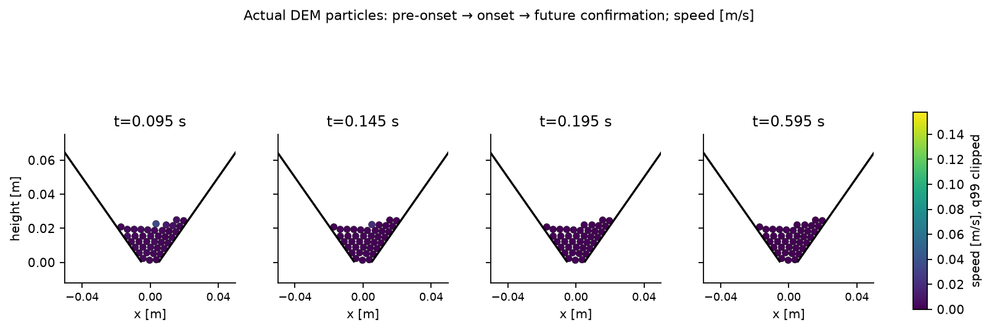
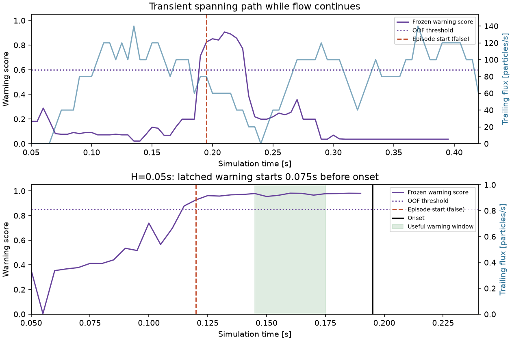
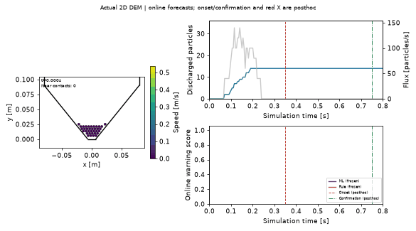
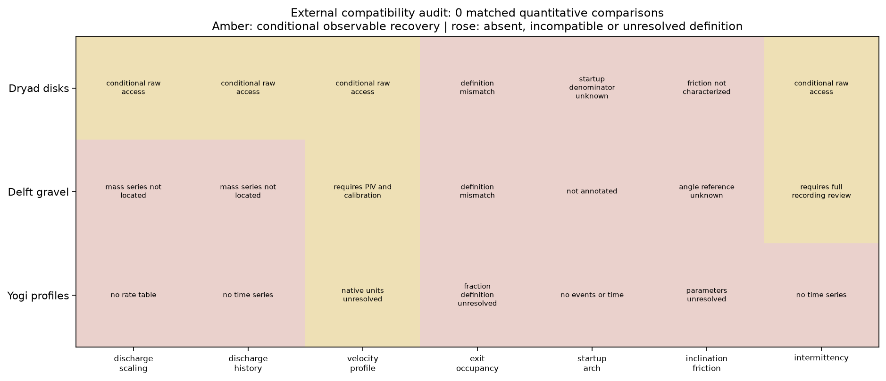

# PharmaFlow-2D

**DEM-based granular hopper simulation and AI-assisted flow diagnostics** — a research-oriented proof of concept for powder handling in pharmaceutical manufacturing.

> **Status:** M1-M6A are implemented. 172 tests pass, including strict CUDA checks. M4B's frozen physics rule remains competitive; M5 provides an interactive research dashboard. M6A audits three external sources and establishes **limited comparison only**: quantitative physical calibration remains unresolved. No industrial performance or deployment claim.

## The engineering problem

Granules in a hopper can flow intermittently or form a stable arch above the outlet (clogging). We aim to (1) simulate particle motion using a **2D Discrete Element Method (DEM)** solver; (2) validate aggregate flow behavior against published DEM/experimental measurements; (3) generate multiple independent operating-condition trajectories; (4) predict early clogging risk; and (5) compare design settings within the solver's validity range.

**Why DEM, not CFD?** This version models contacting dry particles. A continuum CFD solver is better for liquid mixing or fluid pressure/heat transfer; a coupled CFD–DEM model is out of scope.

## Primary reference paper and open dataset

Yogi, J. & Khakhar, D. (2026). *Gravity-driven granular flow from a wedge-shaped hopper: Analysis of the exit region.* Physical Review E 114, 015418. DOI: [10.1103/1ryw-6q89](https://doi.org/10.1103/1ryw-6q89).

Official public reference dataset: [Zenodo 20554446](https://zenodo.org/records/20554446) (DOI: [10.5281/zenodo.20554446](https://doi.org/10.5281/zenodo.20554446)).

Published files (about 30.4 MB in total):
- `quasi2D-sim.numbers` — quasi-2D simulation data (~10.9 MB)
- `quasi2D-expt.numbers` — quasi-2D experimental data (~6.9 MB)
- `3D.sim.numbers` — 3D simulation data (~12.5 MB)

**Scientific limitation:** The study uses quasi-2D geometry and **3D DEM particles**, not the same thing as a strictly 2D disk solver. The `.numbers` layout and whether it includes framewise trajectories must be inspected before assigning column meanings. We use these files as reference data for comparisons where quantities are comparable; we do not promise exact reproduction of the authors' full DEM solver.

Secondary solver inspiration: [Taichi DEM example](https://github.com/taichi-dev/taichi_dem). Its simple example omits tangential contact force and particle rotation; these are required for a stronger research-grade DEM implementation.

## Requirements

- JupyterHub in Docker; **no sudo/root/Docker daemon required**
- User-writable workspace plus `conda` or `pip`
- NVIDIA A100 80GB optional for acceleration, provided CUDA is exposed to the notebook process
- 4+ GB free workspace initially (reference data is small; future rollouts can grow)
- No solver installation via `apt`, OpenFOAM, YADE, or LAMMPS required in phase 0

## Quick start (JupyterHub terminal)

```bash
git clone https://github.com/Ditt-A/PharmaFlow-2D.git
cd PharmaFlow-2D
conda env create -f environment.yml
conda activate pharmaflow-2d
python -m pip install -e .
python -m ipykernel install --user --name pharmaflow-2d --display-name "Python (PharmaFlow-2D)"
python scripts/check_env.py
python scripts/download_reference.py --subset sim
python scripts/inspect_reference.py
python -m pytest -q
```

The NumPy CPU solver requires no Taichi, PyTorch, CUDA toolkit, sudo or display.
For optional acceleration, reference table inspection and tests:

```bash
python -m pip install -e '.[acceleration,reference,test]'
```

On this JupyterHub container, GLIBC is 2.31. The Taichi 1.7.4 wheel requests
`GLIBC_2.32` and cannot import. The acceleration extra and environment file pin
**Taichi 1.7.3**, verified with real CPU/CUDA kernels on the A100. Do not replace
the container's system GLIBC. See the [upstream report](https://github.com/taichi-dev/taichi/issues/8768).

If `conda` is unavailable, use a user-owned virtual environment and `pip install -e .` instead. In Jupyter choose the **Python (PharmaFlow-2D)** kernel after registering it.

**M4A machine learning:** Use `pip install -e '.[ml,test]'` or
`pip install -r requirements-ml.txt` in the existing environment. These CPU
baselines use scikit-learn and XGBoost CPU; PyTorch/GPU training is unnecessary.
Taichi remains pinned to 1.7.3.

## Data commands

```bash
# Manifest only; no data downloaded
python scripts/download_reference.py --list

# Default: download quasi2D-sim.numbers and verify published checksum
python scripts/download_reference.py --subset sim

# Optionally add experimental data, or all three published files
python scripts/download_reference.py --subset expt
python scripts/download_reference.py --subset all

# Inspect format without making unsupported assumptions about columns
python scripts/inspect_reference.py
```

Data is downloaded **on the JupyterHub machine**, not into GitHub. The downloader uses Zenodo's public record API and checks MD5 checksums when supplied in the manifest.

The Numbers parser now reads the actual sheets/tables, verifies the ZIP and MD5,
and exports `outputs/metrics/reference_schema.json`. The inspected simulation
file contains four aggregate profile/map tables for D=2 cm and D=3 cm; its headers
do not provide particle IDs or timestamps. See [the schema audit](docs/REFERENCE_SCHEMA.md).

## Run the M1 simulator

```bash
# Real 100-particle discharge; NPZ + JSON provenance and a headless Pillow GIF
python scripts/run_hopper.py --backend cpu --particles 100 --duration 0.6 \
  --output outputs/rollouts/m1_hopper.npz --gif outputs/animations/m1_hopper.gif

# Narrow outlet: retain particles and examine a persistent contact bridge
python scripts/run_hopper.py --config docs/m1_narrow.json --duration 0.8 \
  --sample-every 500 --output outputs/rollouts/m1_narrow.npz \
  --gif outputs/animations/m1_narrow.gif
python scripts/validate_m1.py

# Optional explicit CUDA; fails clearly if CUDA is unavailable
python scripts/run_hopper.py --backend cuda --particles 50 --duration 0.002 \
  --output outputs/rollouts/m1_cuda_smoke.npz

# --backend auto tries CUDA and reports a NumPy fallback on failure
# Include strict optional Taichi CPU and CUDA physics parity tests
PHARMAFLOW_TEST_TAICHI=1 python -m pytest -q
```

Each run starts from a seeded nonoverlapping fill, settles behind a finite gate,
opens the actual outlet, and integrates particle/wall contact forces. The GIF is
generated from those trajectories and shows particle spin, speed and discharge
count. Simulation time and animation playback time are distinct.

CUDA currently evaluates the contact law in f64; spatial hashing, contact memory,
force reduction and integration stay on CPU. It is a tested hybrid backend and
does not promise a speedup at 50–200 particles. CPU is the default.

Read [the physical model and numerical limits](docs/M1_METHODS.md) and
[node680 verification evidence](docs/M1_VERIFICATION.md). Generated trajectories
and full animations stay in ignored local folders.

## M2 numerical validation and controlled experiments


This optimized preview contains 36 actual solver frames. Full-size wide/arch
GIFs and PNG snapshots are generated locally. The M2 campaign includes 24
repeated cases (8 configurations × 3 seeds), 6 paired timestep runs, controlled
analytic energy/contact benchmarks, independent replay checks and an audit of
all 14 published Numbers tables.

- Elastic maximum energy error decreases **1.277% → 0.635% → 0.316%** at dt,
  dt/2 and dt/4. Individual many-body trajectories retain measurable errors.
- The wide outlet empties for all three seeds. At D/d=3, two seeds empty and
  one retains a finite-window arch; another completed run temporarily pauses.
- All 24 repeated runs conserve particles and pass sidewall leak checks.
- One deliberately reported pilot fails the unchanged overlap guard.
- Published data contains fragmented numeric strings and unresolved units;
  the reference comparison is explicitly partial and qualitative.

Read [M2 validation and exact reproduction commands](docs/M2_VALIDATION.md),
[reference comparison limits](docs/M2_REFERENCE_COMPARISON.md), and
[quantitative CSV/JSON/PNG results](docs/results/m2/).

```bash
python scripts/run_m2.py --suite configs/m2/sweep.json --output outputs/metrics/m2/sweep --jobs 4
python scripts/run_m2.py --suite configs/m2/convergence.json --output outputs/metrics/m2/convergence --jobs 3
python scripts/benchmark_m2.py --cuda
```

These are a small research pilot, not a permanent-clogging classifier, an
industrial material calibration, or a full reproduction of the published DEM.

## M3 scientific dataset and first-event labels



The bounded M3 campaign performs **6 stiffness checks + 18 pilot + 12 adaptive
runs**, then stops. All 36 attempts succeed; 30 independent runs enter the
dataset, with 11 finite-duration first-arch events. Geometry-controlled outlet
studies keep the requested wall angle fixed. Three structurally different packing
families, five seeds and transition cases avoid using only trivial anchors.

Selected numerics are kn=4000 N/m, kt=1000 N/m and dt=5e-6 s. Maximum dataset
overlap is 0.0834 R, below the unchanged 0.15 R guard. The dataset contains 9030
feature rows and 18060 time/horizon label rows, with targets for H=0.05/0.10 s.
Future-only confirmation uses a 0.4 s common-contact persistence window; predictors
are instantaneous or trailing-only. Post-onset and empty states are excluded.

Run-grouped and complete-configuration holdouts are both supplied. The M3 release
fits no encoder, normalizer or predictive model. Naturally censored runs are absent
in this small cohort; censoring is tested with toy cases and 11 truncated real
prefixes, without adding duplicated training trajectories.

```bash
python -m pip install -e '.[dataset,acceleration,test]'
python scripts/run_m3.py --plan configs/m3/pilot.json --jobs 4
# Review the pilot before the documented 12-run adaptive expansion.
python scripts/run_m3.py --plan configs/m3/production.json --jobs 4
python scripts/build_m3_dataset.py
python scripts/audit_m3.py
python scripts/plot_m3.py
```

Raw trajectories stay in `data/simulated/m3/`; Parquet tables, labels, feature
dictionary and splits stay in `data/processed/m3/`. Both directories are ignored
by Git. Only compact checksum manifests, reports and selected figures are
published. See [dataset design/reproduction](docs/M3_DATASET.md),
[labeling protocol](docs/M3_LABELING_PROTOCOL.md), [quality report](docs/M3_QUALITY_REPORT.md)
and [lightweight results](docs/results/m3/). The strict validation/test sets each
contain only one event-bearing run; this release supports data-pipeline research,
not strong claims about predictive performance.

## M4A AI early-warning baselines

**M4A_BASELINE_COMPLETE_BUT_DATA_INSUFFICIENT_FOR_GENERALIZATION**

M4A preserves all 30 M3 runs, 11 first events, labels/checksums and published
splits. It fits logistic regression, Random Forest and XGBoost across six
static/current/temporal/proxy-removal ablations, plus constant and current-state
rule baselines. Both H=0.10/0.05s and both grouped benchmarks are evaluated.
Training-only grouped OOF predictions select models and episode thresholds;
all choices are frozen before validation/test scoring. Models and full
predictions remain local.

| Frozen H=.10 candidate | Validation AP | Test AP | Test useful warnings >=.02s | Test false episodes |
| --- | ---: | ---: | --- | ---: |
| Run-grouped: current-state Random Forest | .7593 | .8900 | 1/2 events | 0 |
| Configuration holdout: current-state XGBoost | .7698 | .9926 | 1/1 event | 0 |

Run-grouped test leads are .040s and .005s; the latter is imminent detection.
The strict test lead is .080s on a single event, giving weak generalization
evidence. At H=.05, selected candidates warn too early or miss the test events,
giving **zero valid test-event warnings despite high frame AP**. Static-only
models localize onset poorly, and the simple physics rule remains competitive.
More complex ML is not justified by this cohort.



```bash
conda activate pharmaflow-2d
python -m pip install -e '.[ml,test]'
export OPENBLAS_NUM_THREADS=2 OMP_NUM_THREADS=2 MKL_NUM_THREADS=2
python scripts/train_m4.py
python scripts/evaluate_m4.py
python scripts/analyze_m4_errors.py
python scripts/audit_m4.py
PHARMAFLOW_TEST_TAICHI=1 python -m pytest -q
# Existing completed experiment: audit or regenerate plots, never overwrite its freeze.
python scripts/evaluate_m4.py --plots-only
```

The local frozen M3 Parquet files are required; these commands launch no DEM
simulations. See [baseline/data protocol](docs/M4_BASELINES.md),
[quantitative frame/event evaluation](docs/M4_EVALUATION.md),
[readiness and proposed M4B budget](docs/M4_READINESS.md), and
[compact results/figures](docs/results/m4/). The 48-attempt expansion proposed
at the M4A release is now evaluated in M4B below.

## M4B independent dataset expansion and chronological warnings

**M4B_RULE_BASELINE_REMAINS_COMPETITIVE**

The complete budget is **48/48 valid new runs**, zero failures, 31 independent
first-arch events and zero naturally censored cases. Pilot review precedes 24
controlled development runs. Twelve evaluation runs from four new physical
configurations are frozen before outcomes and generated only after model/policy
selection is frozen. All M3/M4A labels, splits, models and results remain intact.

Full chronological replay uses current observations, never an oracle onset gate.
For primary H=.10s on **seven locked events**:

| Prespecified candidate | Useful warnings >=20ms | False first-event forecasts | Mean valid lead |
| --- | --- | ---: | ---: |
| Selected new full-feature XGBoost | 7/7 | 12 | 77ms |
| Development-informed physics rule | 7/7 | 8 | 63ms |
| Original frozen M4A physics rule | 7/7 | **0** | 58ms |

Late post-onset notifications are counted separately and included conservatively
in false first-event forecast burden. H=.05s selected ML improves useful recall
to 5/7 versus the informed rule's 4/7, while false forecasts rise to 17 versus 14.
This does not establish ML superiority. Four test configurations, startup-blocked
cases and absent natural censoring still limit generalization.



```bash
python scripts/run_m4b.py --phase freeze
python scripts/run_m4b.py --phase pilot --jobs 4
python scripts/evaluate_m4b.py --stage build-pilot
# Review pilot before the documented adaptive plan.
python scripts/run_m4b.py --phase adaptive --jobs 8
python scripts/evaluate_m4b.py --stage build-development
python scripts/evaluate_m4b.py --stage train
# Locked generation requires the completed model/policy freeze.
python scripts/run_m4b.py --phase locked --jobs 8
python scripts/evaluate_m4b.py --stage evaluate
python scripts/evaluate_m4b.py --stage visualize
python scripts/evaluate_m4b.py --stage audit
python scripts/summarize_m4b.py
python scripts/plot_m4b_diagnostics.py
```

Use the existing conda environment and local M3/M4A assets. Completed phases
verify cached checksums; training/evaluation refuse overwrite. On an existing
release, audit/plot saved results instead. Source, numerical guard and Taichi
1.7.3 are preserved. Observed solver cost is **42.34 summed phase minutes /
3.81 worker-hours**, excluding training, plots and tests. No additional budget
or neural model is launched. See [expansion/reproduction](docs/M4B_EXPANSION.md),
[quantitative generalization evaluation](docs/M4B_GENERALIZATION.md),
[readiness decision](docs/M4B_READINESS.md) and [compact evidence](docs/results/m4b/).

## M5 — Interactive DEM research dashboard

Replay genuine stored DEM states, monitor the unchanged frozen M4A rule beside
the frozen M4B ML comparator, and run a bounded custom CPU demo explicitly.
Play/pause, frame scrubbing, contacts, speed colors, physical-time traces,
warning logs, PNG download and short GIF export are available. Research-only
onset/confirmation annotations are separated from causal online monitoring.


```bash
conda activate pharmaflow-2d
python -m pip install -c configs/m5/existing_node_constraints.txt -e '.[dashboard]'
python -m streamlit run app/streamlit_app.py --server.address 127.0.0.1 --server.port 8501
```

Locally open `http://127.0.0.1:8501`. JupyterHub needs its existing authenticated
proxy route; where none is available, the self-contained notebook/offline HTML
viewer needs no web port. Historical trajectories/models are deliberately kept
out of Git: restore local release assets or copy the small local portfolio
bundle described in [launch and fallback instructions](docs/M5_DASHBOARD.md).

The separate `operational-observation-v1` audit preserves all original labels:

| Historical category | M3 + M4B |
|---|---:|
| Independent runs | 78 |
| Startup blockage | 19 |
| Post-discharge first arch | 23 |
| Established-flow arch, subset of post-discharge | 7 |
| Temporary interruption episodes / affected runs | 7 / 4 |
| Completed discharge / unresolved runs | 36 / 0 |

One crossing does not establish flow: the new criterion requires five crossings
across at least three frames in a complete 100ms window with no gap >40ms.
Only **two** locked-test arches meet this preceding-flow criterion. The original
rule's 7/7 useful warnings and zero false first-event forecasts remain a specific
M4B observation, not proof of generalization.

Three genuine scenes include [continuous discharge](docs/results/m5/continuous.gif),
[startup blockage](docs/results/m5/startup.gif), and a
[temporary pause followed by resumed discharge](docs/results/m5/resumed.gif).
Recreate them without solving or training:

```bash
python scripts/audit_m5.py
python scripts/export_m5.py
PHARMAFLOW_TEST_TAICHI=1 python -m pytest -q
```

**149 tests pass** (116 historical + 33 M5). All 700 snapshotted historical files
and all core dependency versions remain unchanged. One explicit .12s/30-disk
Run-button validation took 16.14 CPU seconds; its local output is separate from
research releases. The workspace demo budget is six attempts and three total
requested simulated seconds, including failures; five attempts remain on the
existing node. Slider changes never launch the solver.

These are uncalibrated dry 2D disks and warning scores, not validated industrial
risk probabilities. No neural model, new training or research campaign is added.
See [operational taxonomy](docs/M5_OPERATIONAL_EVENTS.md),
[dashboard and exports](docs/M5_DASHBOARD.md), and the separate
[physics calibration gap analysis](docs/M5_CALIBRATION_GAPS.md).

## M6A — External physics benchmarking and calibration feasibility

**M6A_LIMITED_COMPARISON_ONLY**

Three independent external sources are audited: [Dryad Cornerstones](https://doi.org/10.5061/dryad.cvdncjtb5),
[Delft hopper experiments](https://doi.org/10.4121/C.6415736), and the existing
[Yogi & Khakhar reference](https://zenodo.org/records/20554446).
Seven benchmark specifications distinguish number/mass/normalized discharge,
time histories, velocity, occupancy definitions, operational events, controlled
inclination/friction effects and intermittency.



- Successful new metadata/text/preprint cache: **480,530 bytes**, including
  fourteen MD5-verified Delft README/info files (**13,794 bytes**). No large
  archive downloads. Existing Zenodo data (**30,393,158 bytes**) are reverified.
- Dryad metadata and published SHA-256 values are accessible, but four tested
  small file downloads return HTTP 403; raw measurement schema/units remain
  unverified. Its tridisperse confined disks are not our monodisperse wedge.
- Delft's collection total (201 experiments) conflicts with its listed repeat
  counts (sum 231). Six headered acquisition rows conflict with their catalogs;
  ten headerless annotations remain provisional. Irregular 3D gravel and its
  surface imaging cannot be equated with complete disk trajectories.
- Experimental Yogi profiles yield only **43/160 parseable y/uy pairs per outlet**,
  with units/averaging unresolved. Native plots have separate axes and no
  claimed physical agreement.
- **39 training-only runs screened; 0 qualify for sustained-flow scaling**.
  Fills are ≤50 particles, with at most 29 post-buffer crossings. No Beverloo
  coefficient/exponent or physical parameter is fitted. Zero-flow arches are
  never treated as free-flow regression points.

```bash
conda activate pharmaflow-2d
python scripts/audit_m6_sources.py --fetch-small  # bounded first ingest
python scripts/audit_m6_sources.py               # offline provenance/checksums
python scripts/benchmark_m6.py                   # existing training data only
PHARMAFLOW_TEST_TAICHI=1 python -m pytest -q
```

**172 tests pass** (149 historical + 23 M6). No new campaign/demo DEM, ML training, historical
relabeling or M5 demo-budget consumption. Source and raw data remain separate;
all numerical/model-form/material/experimental uncertainties are distinguished.
See [external audit](docs/M6_EXTERNAL_DATA_AUDIT.md),
[benchmark definitions](docs/M6_PHYSICS_BENCHMARKS.md),
[calibration feasibility](docs/M6_CALIBRATION_FEASIBILITY.md), and
[readiness / bounded M6B proposal](docs/M6_READINESS.md). M6B is not launched.

## Repository layout

```text
PharmaFlow-2D/
├── AGENTS.md                     # Coding-agent scope and acceptance criteria
├── README.md
├── environment.yml
├── requirements-ml.txt
├── pyproject.toml
├── .gitignore
├── data/README.md                # Raw data conventions; actual datasets ignored
├── docs/RESEARCH_PLAN.md         # Physics, experimental design, validation
├── notebooks/README.md
├── outputs/README.md             # Generated rollouts/figures/checkpoints ignored
├── scripts/
│   ├── check_env.py
│   ├── download_reference.py
│   ├── inspect_reference.py
│   ├── run_hopper.py
│   └── validate_m1.py
├── src/pharmaflow/
│   ├── __init__.py
│   ├── config.py
│   ├── dataio.py
│   ├── dem.py                     # State, contact assembly, integration, outlet
│   ├── contact.py                 # History friction and normal contact
│   ├── geometry.py                # Finite walls and wall-crossing detection
│   ├── neighbors.py               # Uniform cells / Verlet skin
│   ├── taichi_backend.py          # Optional f64 CPU/CUDA contact kernel
│   ├── diagnostics.py             # Finite-window arch observation
│   ├── run.py                     # Reproducible NPZ / JSON metadata
│   └── visualize.py               # Headless solver trajectory GIF
└── tests/                         # Configuration and physical validation
```

The DEM solver, M2 runner, M3 dataset pipeline, M4A/M4B CPU baselines and headless
visualizers and M5 interactive research dashboard are implemented. Reference
calibration and broader established-flow event coverage remain unresolved.
Optimization is outside the current scope.

## Planned milestones

1. **M0 — Setup:** environment, repeatable downloads, checksum validation, format inspection, smoke tests.
2. **M1 — Physical DEM:** explicit timestep integrator; gravity; normal/tangential damping; Coulomb friction; particle rotation; wall/particle contacts; hopper geometry; save particle trajectories. Unit/integration tests must pass.
3. **M2 — Validation:** reference data schema audit; dimensional consistency; particle conservation; contact stability; discharge-rate and velocity comparisons where valid. Record any non-comparable reference variables.
4. **M3 — Scientific synthetic dataset:** numerical preparation, budgeted generation, first-event labels, censoring, causal features, grouped splits and QA. Implemented without training.
5. **M4A — Research baselines:** implemented with train-only preprocessing/OOF selection, frozen held-out evaluation, independent-event warnings and small-sample limitations. Acquire more evidence before advanced modeling.
6. **M4B — Targeted expansion:** implemented with 48 new runs, independent configuration testing and causal online replay. Physics rules remain competitive; no neural complexity is justified yet.
7. **M5 — Operational diagnostics:** implemented with a separate causal taxonomy, interactive actual-state viewer, bounded CPU demos, frozen warning comparison and explicit calibration gaps.
8. **M6A — External physics:** implemented with bounded independent-source audits, explicit physical benchmark gates and a conditional calibration plan. Limited comparison only; no fitted material parameters or new campaign.

## Research integrity

- **This is not internal Kalbe data** and does not claim to solve a verified problem at Kalbe.
- The simulator is not a validated commercial pharmaceutical process model.
- Avoid random frame-level train/test splits (temporal leakage).
- A reconstruction from published aggregate data is **not** a reproduced paper model.
- Report both successful and failed runs, conditions, computational cost, and limits.
- Do not label the reference experimental videos/positions as DEM simulations.

## Next step for Codex

Preserve M1-M6A tests, historical source hashes/splits, frozen artifacts and test
results. Resolve calibration and event-type/policy limitations using development
groups. Any new campaign requires a separate budget; do not recycle the locked
M4B cohort for tuning or silently exceed its completed 48-attempt ceiling.
The data-first M6B proposal requires separate authorization; do not launch it
or use the remaining M5 dashboard attempts for external benchmarking.
