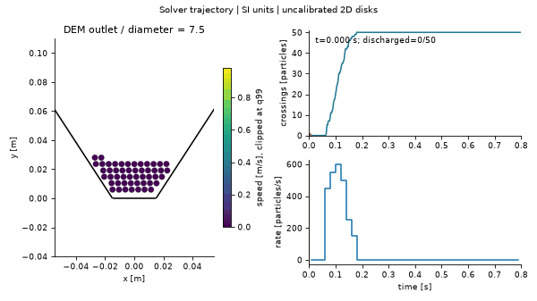
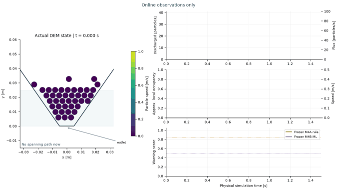
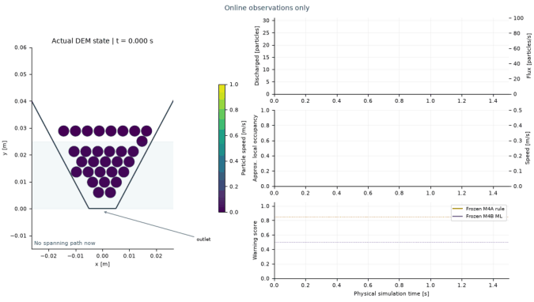
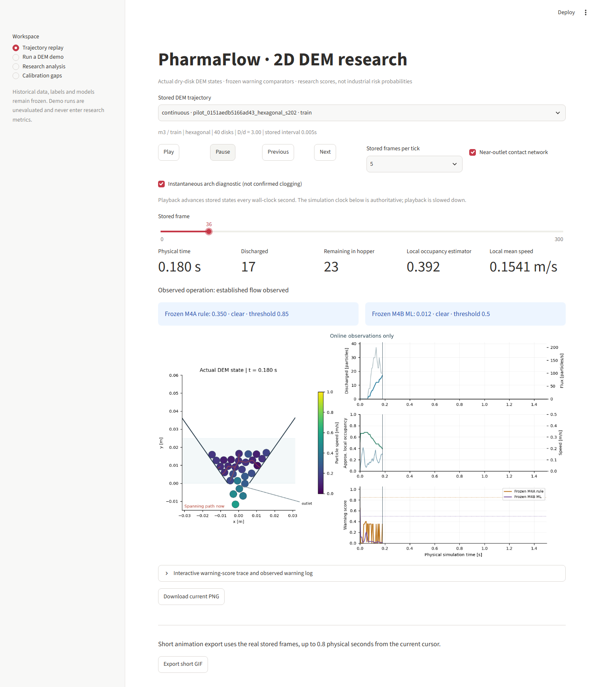
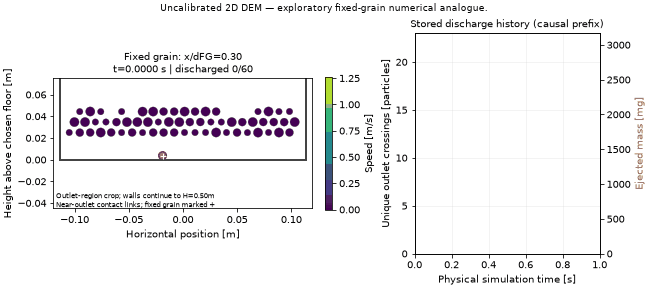
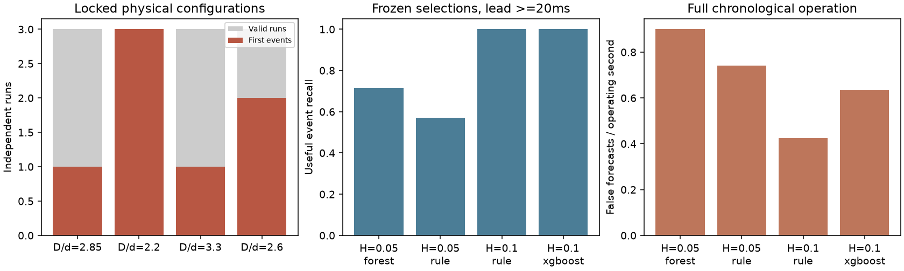
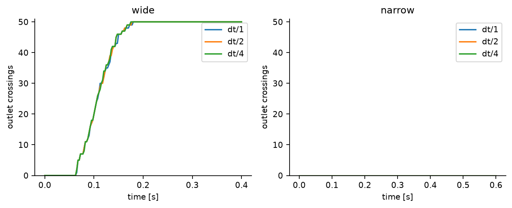

# PharmaFlow-2D visual gallery

Every moving particle scene below is rendered from an existing solver trajectory. M8 reuses the committed files without changing their frame sampling or scientific meaning. Full NPZ trajectories remain local and ignored.

## Continuous discharge and speed

Source: M2 compact preview; see [validation report](M2_VALIDATION.md). The particle colors encode speed, and the preview uses stored solver states.

## Persistent arch / startup blockage

Source: M5 representative scene; see [operational event report](M5_OPERATIONAL_EVENTS.md). The finite observation follows the project's event protocol and does not prove indefinite clogging.

## Temporary interruption followed by resumed flow

Source: M5 replay of a genuine stored run. Later outlet crossings distinguish this retrospective example from a persistent arch annotation.

## Interactive dashboard

Source: M5 dashboard validation. It displays actual trajectory frames and synchronized traces. Without ignored local trajectory files, a fresh clone displays an explicit restore-artifacts message.

## Fixed-grain numerical analogue

M7A used 12 valid one-second runs; all were right-censored for a confirmed arch, and none reproduced the external fixed-grain observation. See [pilot results](M7A_PILOT_RESULTS.md).

## Physics rule and ML evaluation

The original frozen M4A rule produced 7/7 useful warnings and zero false first-event forecasts on the seven-event M4B locked cohort. This small sample is not evidence of universal generalization. See [M4B evaluation](M4B_GENERALIZATION.md).

## Numerical convergence

This is a numerical refinement result, not external physical calibration. See [M2 validation](M2_VALIDATION.md).